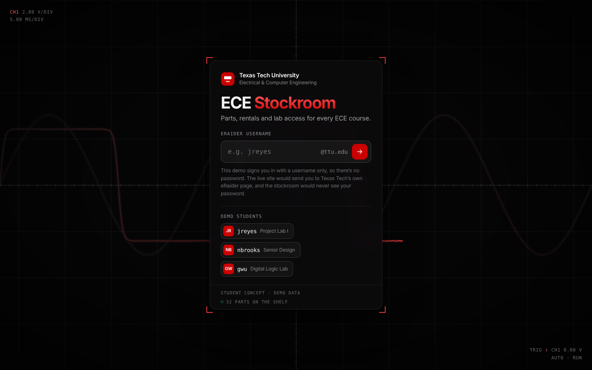
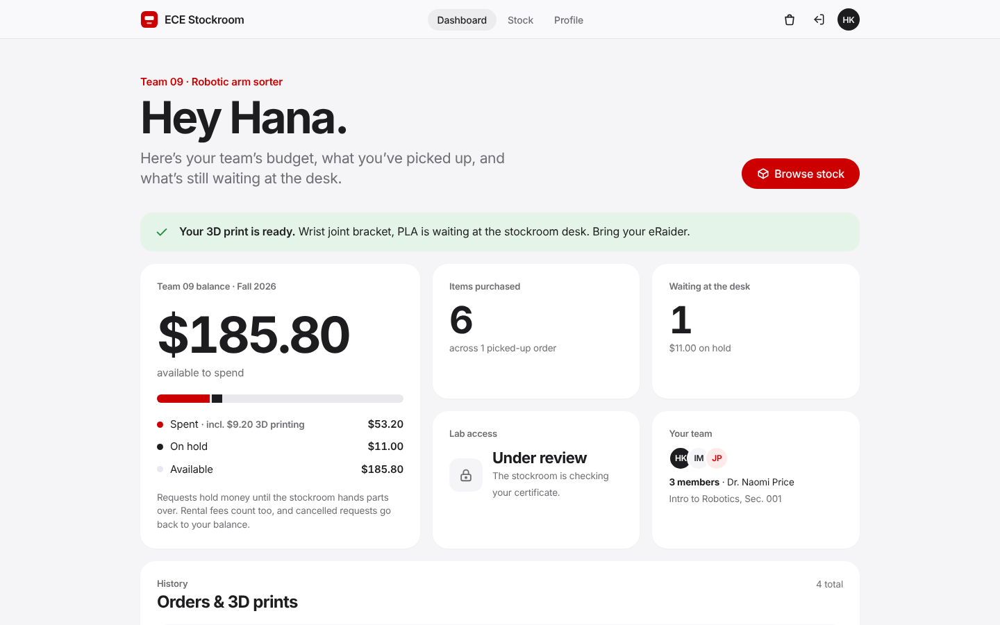
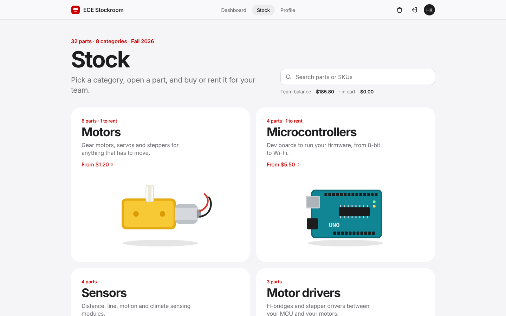
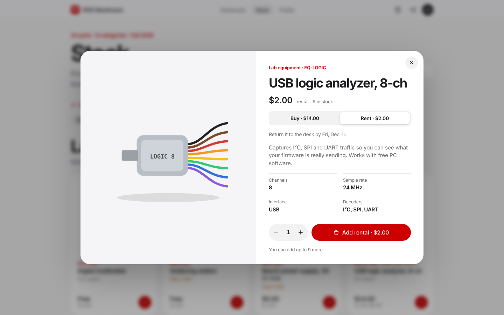
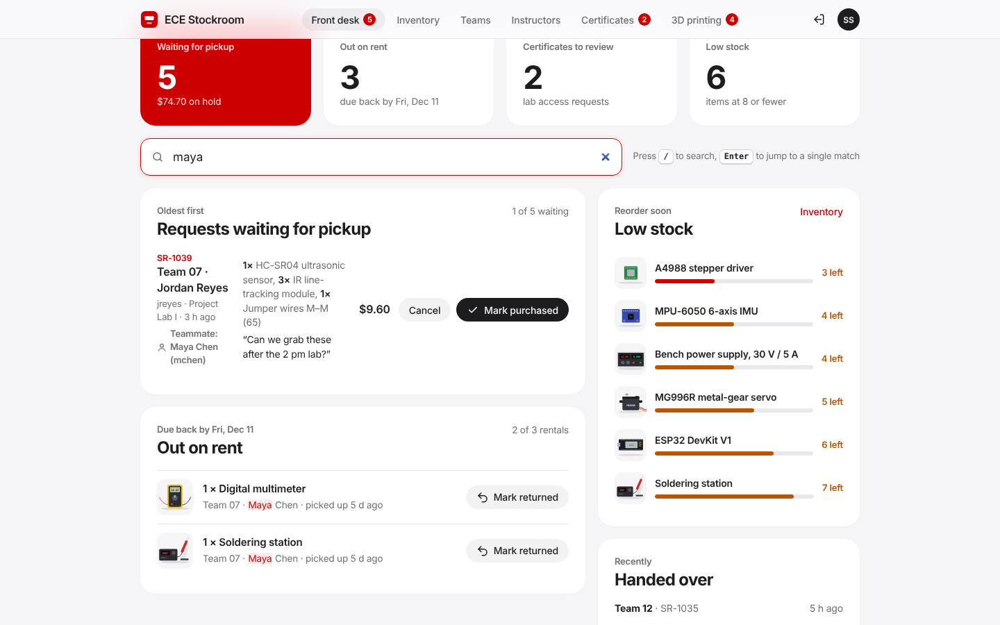
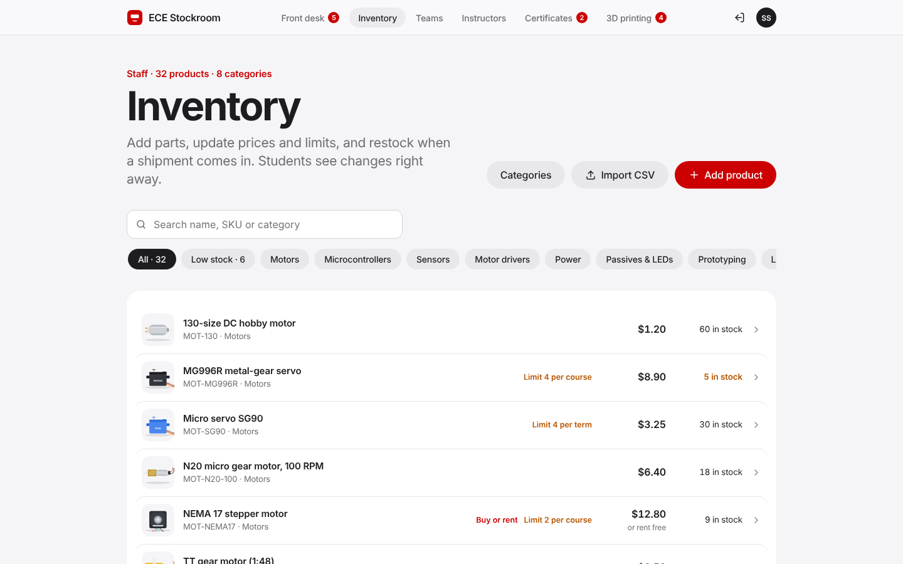
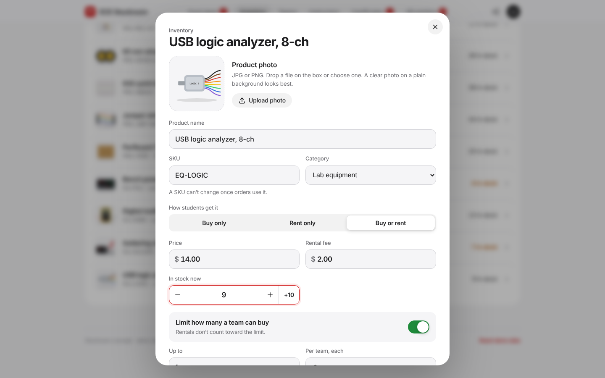
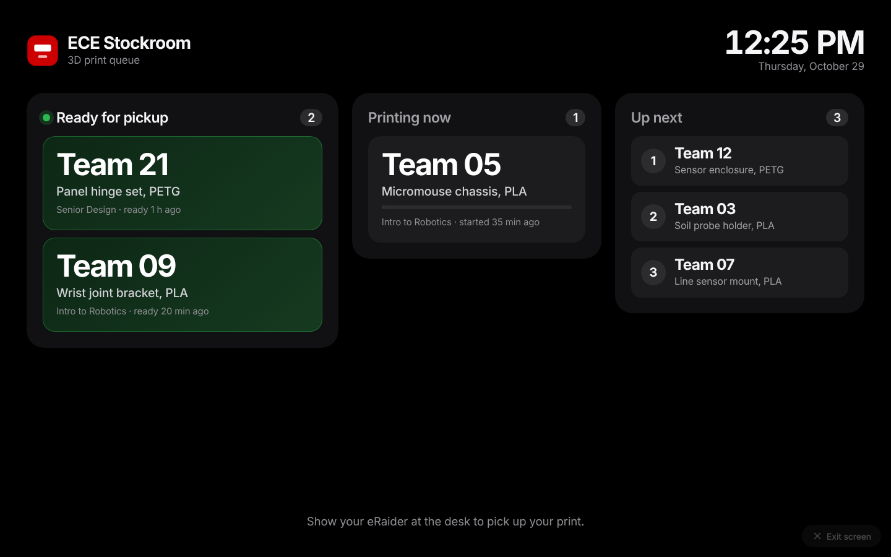
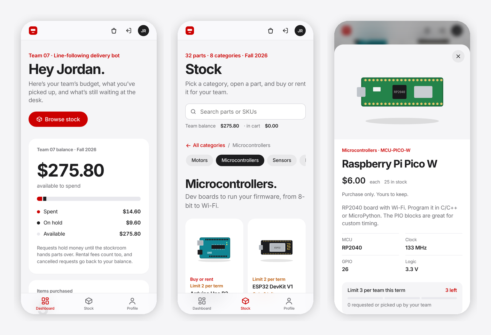

# ECE Stockroom

A web app for the Electrical & Computer Engineering stockroom at Texas Tech. Students use it to find parts, request or rent them against their team's budget, and see when things are ready at the desk. Stockroom staff use the same site to hand orders over, keep inventory up to date, review lab safety certificates and run the 3D print queue.

This is a working prototype with demo data. It runs entirely in the browser, so anyone can open it and click through both the student side and the staff side.

**[Open the live demo](https://siammohammad10.github.io/Weekend-Projects/ece-stockroom/)**

> This is an independent student project. It is not an official Texas Tech University website and is not affiliated with or endorsed by the university.



## Why I built it

I pick up parts from the stockroom almost every week for labs and projects. The current site is hard to use and has its share of bugs, and a lot of what actually happens at the desk, like team budgets, rentals and 3D print pickups, isn't on it at all.

I wanted one place where a student can see exactly what their team has left to spend and what's waiting for them, and where staff can keep the shelf, the budgets and the print queue current without extra paperwork.

## What it does

### For students

- **Sign in with eRaider.** Students only ever see the student side. Staff accounts open the stockroom tools.
- **Browse and search stock** by category, with photos, specs, live stock counts and prices.
- **Buy, rent, or both.** Each part can be purchase only, rent only, or either one. Rentals show their return date.
- **Purchase limits** per team, set per term or per course (for example, 5 TT motors per term).
- **Team budgets set by course.** The dashboard shows what's been spent, what's on hold for requests waiting at the desk, and what's left.
- **Cart and checkout** that shows the balance before and after, with an optional note for the desk.
- **Order and 3D print history**, plus a banner when a print is ready for pickup.
- **Profile** with a photo and a lab safety certificate upload. Once staff verify the certificate, the student gets lab access.

### For stockroom staff

- **Front desk.** Requests waiting for pickup, oldest first. Mark a request purchased when the parts are handed over, or cancel it to put the money back in the team's budget. Rentals get checked back in from the same page.
- **Inventory.** Add and edit products with photos, prices, rental fees, limits and stock. Hide items without losing their order history, manage categories, and import a whole inventory from a CSV file.
- **Teams and instructors.** Every team's allocation, spending and members, grouped by course and instructor.
- **Certificates.** Preview each upload, then verify or reject it.
- **3D printing.** Jobs move from in line to printing to ready to picked up. Staff enter the cost when a print is done and it comes out of the team's budget. A full-screen board can run on a monitor at the desk so students can see when their print is ready.

## Screenshots

| Student dashboard                                              | Stock by category                                      |
| -------------------------------------------------------------- | ------------------------------------------------------ |
|            |         |
| **Product page**                                               | **Front desk (staff)**                                 |
|  |    |
| **Inventory (staff)**                                          | **Product editor (staff)**                             |
|               |  |

The 3D print pickup board, meant for a monitor at the desk:



On phones the navigation moves to a tab bar at the bottom:



## Try it

There's nothing to install and no build step. Either:

- open `index.html` in a browser, or
- serve the folder with `npx serve .` or `python3 -m http.server`, then open the address it prints.

The live demo is hosted with GitHub Pages from this repository's `main` branch, so any change pushed to `main` shows up there within a minute or two.

### Demo accounts

Type the eRaider username on the sign-in screen. The demo has no passwords.

| Username    | Who                        | Good for checking                         |
| ----------- | -------------------------- | ----------------------------------------- |
| `jreyes`    | Student, Project Lab I     | A pending request, rentals, the cart      |
| `nbrooks`   | Student, Senior Design     | A larger course budget                    |
| `gwu`       | Student, Digital Logic Lab | A smaller course budget                   |
| `hkim`      | Student, Intro to Robotics | A 3D print that's ready for pickup        |
| `stockroom` | Stockroom staff            | Front desk, inventory and the other tools |

The staff account isn't listed on the sign-in screen on purpose.

Everything you do is saved in your own browser only. Use **Reset demo data** at the bottom of any page to start over.

## Importing inventory

**Inventory › Import CSV** takes a spreadsheet saved as a CSV file. A sample that uses every column is in [`samples/inventory-sample.csv`](samples/inventory-sample.csv). Importing it as `stockroom` adds ten products and a new Displays category, and updates two existing parts.

| Column        | Required     | What it does                                                                 |
| ------------- | ------------ | ---------------------------------------------------------------------------- |
| `sku`         | Always       | Letters, numbers and dashes. A SKU that already exists updates that product. |
| `name`        | New products | Product name shown to students.                                              |
| `category`    | New products | Category name. A name that doesn't exist yet creates it.                     |
| `price`       | To be bought | Purchase price in dollars, like `6.50`.                                      |
| `rent`        | No           | Rental fee. Blank or `0` means free to borrow.                               |
| `mode`        | No           | `buy`, `rent` or `both`. Defaults to `buy`.                                  |
| `stock`       | No           | How many are on the shelf.                                                   |
| `limit`       | No           | Most a team can buy. `0` removes an existing limit.                          |
| `limit_per`   | No           | `term` or `course`.                                                          |
| `description` | No           | Shown on the product page.                                                   |

A few rules:

- The first row must be the column names. Column order doesn't matter, and extra columns are ignored.
- For a product that already exists, blank cells keep the current value. That makes it easy to update just the price or just the stock.
- Put quotes around any cell that contains a comma. To use a quote mark inside a quoted cell, double it: `"0.96"" OLED display"`.
- Nothing changes until you confirm. The import screen first shows how many products are new, how many are updates, and which rows were skipped and why.

To export from Excel, use **File › Save As › CSV UTF-8**. From Google Sheets, use **File › Download › Comma-separated values**.

## How it's built

Plain HTML, CSS and JavaScript, with no framework and no build step. The scripts load in order with `defer`, and each file covers one part of the app.

```
Weekend-Projects/ece-stockroom/
├── index.html
├── favicon.svg
├── css/
│   └── styles.css            Layout, components, light and dark themes
├── js/
│   ├── config.js             Logo, term and rental due date
│   ├── utils.js              DOM and formatting helpers
│   ├── icons.js              Inline SVG icons
│   ├── illustrations.js      Drawings for the demo parts
│   ├── catalog.js            Starting categories and parts
│   ├── store.js              State, demo data, budget and limit rules
│   ├── views/
│   │   ├── login.js
│   │   ├── nav.js
│   │   ├── dashboard.js
│   │   ├── stock.js          Stock browser, product sheet and cart
│   │   ├── profile.js
│   │   ├── staff.js          Front desk, teams, instructors, certificates
│   │   ├── printing.js       3D print queue and pickup board
│   │   └── inventory.js      Product editor, categories, CSV import
│   ├── app.js                Rendering, effects and file handling
│   ├── router.js             Browser history: back and forward, refresh, links to a page
│   ├── actions.js            Button actions
│   └── main.js               Event wiring and startup
├── samples/
│   └── inventory-sample.csv
└── docs/
    ├── data-model.md
    └── screenshots/
```

Code formatting uses Prettier (`npm install`, then `npm run format`).

## Customizing

Everything below is a plain text edit. No build step, so save the file and refresh the page.

### Logo

The official Texas Tech logo isn't included in this repository. Only use the approved file from TTU's brand office.

1. Add the file to an `assets` folder, for example `ece-stockroom/assets/ttu-logo.svg`. The sign-in screen is always dark, so use the white or reversed version of the logo.
2. In `js/config.js`, set `LOGO_URL` to its path:

   ```js
   const LOGO_URL = 'assets/ttu-logo.svg';
   ```

The logo replaces the red mark and the "Texas Tech University" text at the top of the sign-in screen. It's shown at up to 64 px tall. Change `.logo-img` in `css/styles.css` to make it bigger or smaller.

The small red mark in the top bar and the browser tab icon are separate. They're the SVG inside the `brand` button in `index.html` and the `favicon.svg` file.

### Term and rental due date

In `js/config.js`:

- `TERM` is the term name shown across the app, like `'Spring 2027'`.
- `RENTAL_DUE` is the date rentals are due back. The month starts at 0, so `new Date(2027, 4, 7)` means May 7, 2027.

### Teams, instructors, students and budgets

All in the `seed()` function in `js/store.js`:

- `instructors` lists each instructor with their course and section.
- `teams` lists each team with its project, its instructor, its `budget` (that course's allocation in dollars) and its `members`.
- Student usernames are made from the member names: the first letter of the first name plus the last name, so "Jordan Reyes" becomes `jreyes`.
- The staff account is the line that adds `stockroom`. Change the username or name there.
- The demo accounts shown on the sign-in screen are listed in `js/views/login.js`. Update that list if you rename students.

The example orders, certificates, 3D print jobs and print charges are in the same file (`orders`, `certs`, `seedPrints` and `seedCharges`). Delete them to start with a clean slate.

### Parts and categories

The starting catalog is in `js/catalog.js`: `BASE_CATS` for categories and `BASE_ITEMS` for parts, with price, rental fee, mode, stock, limits, description and specs. Each field is explained at the top of the file.

You can also skip the code entirely. Sign in as `stockroom` and use **Inventory** to add, edit and hide products, or import a CSV.

### Colors and text

- Colors are set once at the top of `css/styles.css`. `--accent` is the scarlet used for buttons, prices and links. Dark mode has its own values in the block right after it.
- The sign-in headline and the line under it are in `js/views/login.js`.
- The footer note ("Stockroom concept · demo data") is in `js/app.js`.

### After changing the demo data

Each browser keeps its own saved copy of the demo, so changes to `store.js` or `catalog.js` won't show up for someone who has already opened the site. They can click **Reset demo data** at the bottom of any page. To reset it for every visitor at once, change the `KEY` value at the top of `js/store.js`, for example from `ece-stockroom-demo-v4` to `ece-stockroom-demo-v5`.

## What it would take to run this for real

The prototype keeps all of its data in the browser so it can be shown anywhere. For the stockroom to use it day to day, it would need:

1. **Sign-in through eRaider.** The app would be registered with TTU IT for single sign-on, so students sign in on Texas Tech's own page and the app never sees a password. Whether someone is a student or staff member would come from that sign-in.
2. **A shared database and API.** Orders, inventory, budgets, certificates and print jobs have to live on a server so the desk and every student see the same data. All reads and writes go through `js/store.js`, so that's the one place the API calls would replace local storage.
3. **Course and team data.** Team rosters and each course's allocation would come from the department every term instead of the demo data.
4. **File storage** for product photos and certificate uploads.
5. **Notifications**, such as an email when an order or a print is ready.
6. **An accessibility and security review** before launch.

The records the app works with, and how the budget math works, are described in [`docs/data-model.md`](docs/data-model.md).

## Browser support

Current versions of Chrome, Edge, Safari and Firefox, on desktop and mobile. Light and dark mode follow the device setting.

## Author

Mohammad Siam, Electrical Engineering, Texas Tech University.

Feedback is welcome. Open an issue on this repository with ideas or problems.

## License

MIT. See [LICENSE](LICENSE).
