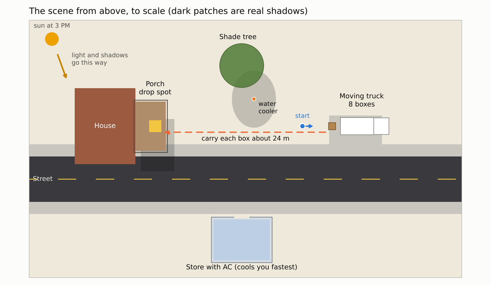
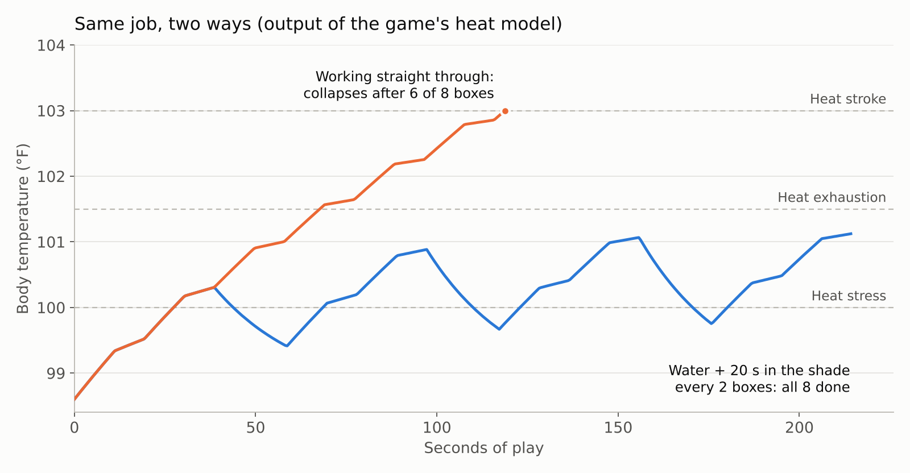
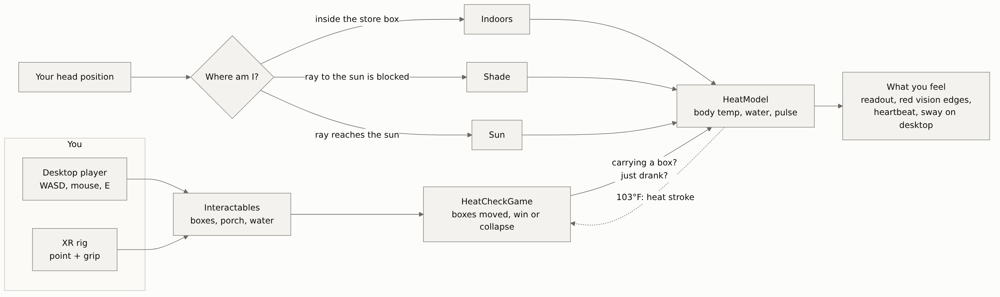

# Heat Check

[](https://github.com/siammohammad10/Weekend-Projects/actions/workflows/heat-check.yml)

A short Unity experience about heat illness, playable on a computer or in a VR headset. It's 3 PM in Lubbock and 104°F, and your job is to carry 8 boxes from a moving truck to a porch down the street. Your body temperature climbs while you work in the sun. Water, shade and air conditioning bring it back down. Push through the warning signs and you'll learn what heat exhaustion and heat stroke look like, and what to do about them.

Heat illness sends people to the ER every summer, often people who kept working because they felt fine. I wanted something that shows how fast that happens and lets you feel it instead of reading a flyer.



The whole scene is built from code, to scale. The dark patches are where the shadows really fall at 3 PM, and the game uses those same shadows to decide whether you're in the shade.



That's the real output of the game's heat model for the same job done two ways. The tests check that it keeps telling this story.

## What it does

| | |
| --- | --- |
| **Task** | Move 8 boxes about 24 m, one at a time, from the truck to the porch. |
| **Your body** | Temperature, pulse and water level, updated every frame from where you are and what you're doing. |
| **Sun vs. shade** | A ray goes from your head toward the sun. If the tree, the porch roof or the truck blocks it, you're in the shade. |
| **Ways to cool down** | Drink at the water cooler, rest in the shade, or go into the air-conditioned store across the street. |
| **Warning signs** | At heat stress the edges of your vision turn orange and you start hearing your heartbeat. At heat exhaustion they turn red, your pulse speeds up, you walk slower and (on desktop only) the view sways. |
| **Endings** | Finish the job and you get your highest temperature, cups of water and time spent cooling off. Reach 103°F and it's heat stroke: the screen fades and explains what to do if you see it in real life. |
| **Desktop or VR** | Plays with keyboard and mouse out of the box. Add the XR Interaction Toolkit and one menu click swaps in a headset rig, with point-and-grip on the same objects. |

## Set it up

You need a computer that runs Unity 6 (Windows, macOS or Ubuntu). A headset is optional.

### 1. Install Unity

1. Install [Unity Hub](https://unity.com/download) and sign in with a free Unity account. The free Personal license is enough.
2. In Unity Hub, go to **Installs → Install Editor** and install the latest **Unity 6 LTS** version.

On Ubuntu, install Unity Hub from Unity's apt repository (the steps are on the download page) rather than a snap or Flatpak build.

### 2. Get the project

```sh
git clone https://github.com/siammohammad10/Weekend-Projects.git
```

Or use **Code → Download ZIP** on GitHub and unzip it.

### 3. Open it

1. In Unity Hub, go to **Projects → Add → Add project from disk** and pick the `heat-check` folder (the one with `Assets` and `Packages` inside it).
2. Click the project to open it. If Hub says the editor version isn't installed, pick the Unity 6 version you installed.
3. The first open takes a few minutes while Unity imports everything. When it's done, the Heat Check scene builds itself and opens, and the Console prints `Heat Check: built Assets/HeatCheck/Scenes/HeatCheck.unity`.

If the scene doesn't open, use the **Heat Check → Open Scene** menu at the top of the editor.

### 4. Install the Input System

1. Open **Window → Package Manager**, choose **Unity Registry** on the left and find **Input System**.
2. Click **Install**. When Unity asks to enable the new input backends, click **Yes**. Unity restarts.

The game also works with Unity's old Input Manager, so you can skip this if WASD already works.

### 5. Play

Press **Play** at the top of the editor, then click in the Game view.

| Key | Does |
| --- | --- |
| W A S D or arrow keys | Walk |
| Mouse | Look around |
| E or left click | Pick up a box, put it down, drink water |
| R | Try again after the round ends |
| Esc | Free the mouse |

Look at the boxes behind the truck and press E to pick one up. Carry it to the yellow square on the porch and press E again.

### Play in VR (optional)

1. In **Package Manager → Unity Registry**, install **XR Interaction Toolkit** (say **Yes** if it asks about the Input System) and **OpenXR Plugin**.
2. Still in Package Manager, select **XR Interaction Toolkit**, open the **Samples** tab and import **Starter Assets**.
3. Open **Edit → Project Settings → XR Plug-in Management**. On the desktop tab, tick **OpenXR**. Under **OpenXR**, add the interaction profile for your controllers (for a Meta Quest, **Oculus Touch Controller Profile**).
4. Choose **Heat Check → Add XR Rig**, then save the scene (Ctrl+S or Cmd+S). This adds the toolkit's rig and turns off the desktop player.
5. Press Play. Point a controller at something and press **grip** to use it. Move with the left thumbstick.

No headset? In **Project Settings → XR Plug-in Management → XR Interaction Toolkit**, turn on the simulator option (**Use XR Interaction Simulator in scenes**, or **Use XR Device Simulator in scenes** in older versions). Press Play and the on-screen guide shows which keys move the simulated head and hands.

With a Meta Quest on Windows, connect it with Quest Link or Air Link before pressing Play.

To go back to keyboard and mouse, delete the XR rig from the scene and tick the checkbox next to **Player (desktop)** in the Inspector.

## How it works



### The heat model

`HeatModel.cs` is plain C# with no Unity code in it, so it can be tested on its own. Every frame it does:

```
change in body temperature = heat taken in − cooling × (body temperature − 98.6°F)
```

| | Heat taken in (°F/s) | Cooling (per second) |
| --- | --- | --- |
| In the sun | 0.030 | sweat only |
| In the shade | 0.003 | sweat + 0.03 |
| Indoors (AC) | 0 | sweat + 0.06 |
| Carrying a box | +0.040 | |

Sweat cooling is 0.01 per second when you're fully hydrated. It drops as you lose water (down to a quarter of that when you're out), because a dehydrated body can't sweat as much. So the less you drink, the faster you heat up and the slower you recover. You lose water faster in the sun and while carrying, and each cup from the cooler gives back 35%.

Time is sped up so an afternoon fits in a few minutes. The numbers were tuned so the game tells a true story, not to predict anyone's real temperature. **It's a teaching tool, not a medical model.**

| Stage | Body temperature | What you'll notice |
| --- | --- | --- |
| Feeling OK | under 100°F | Nothing |
| Heat stress | 100 to 101.5°F | Orange edges, heartbeat, a warning to drink and rest |
| Heat exhaustion | 101.5 to 103°F | Red edges, faster heartbeat, slower walking, the CDC's warning signs on screen |
| Heat stroke | 103°F and up | The round ends |

The 103°F line for heat stroke and the symptoms the game lists come from the CDC's guidance on heat-related illness. The two stages below it are the game's own steps for showing the warning signs as they build.

### Other details

- **Shade is computed, not placed.** `Body.cs` casts a ray from your head toward the sun every frame. The scene builder puts the water cooler exactly where the tree's shadow lands, using the same sun angle.
- **The air-conditioned store** is a box-shaped `IndoorZone`. If your head is inside it, you're indoors.
- **Comfort in VR.** On desktop, heat exhaustion makes the view sway. In a headset, moving the view on its own makes people motion sick, so the XR version only uses the red edges and the heartbeat. The readout follows your head with a slight lag instead of being glued to your face.
- **One set of objects for both modes.** Boxes, the porch and the cooler are `Interactable` components. The desktop player uses them by raycasting from the camera. With the XR Interaction Toolkit installed, `XRSupport.cs` adds an `XRSimpleInteractable` to each one so controllers can hover and grip them too.
- **Optional packages stay optional.** `HeatCheck.asmdef` defines `HEATCHECK_XRI` and `HEATCHECK_INPUT_SYSTEM` only when those packages are installed, so the project compiles with or without them.
- **No asset files to download.** The heartbeat is two low sine "thumps" generated in code, the vignette texture is generated in code, and the scene is built from Unity's basic shapes.
- **Sign text that respects walls.** Unity's built-in 3D text draws on top of everything. `SignText.shader` is a small unlit shader that lets walls hide sign text, and it works in single-pass VR.

## Files

```
heat-check/
├── Assets/HeatCheck/
│   ├── Scripts/
│   │   ├── HeatCheck.asmdef         the game's code, with the optional XR and Input System defines
│   │   ├── HeatCheckGame.cs         one round: picking up, delivering, drinking, the endings
│   │   ├── Make.cs                  helpers for materials and text
│   │   ├── Model/HeatModel.cs       body temperature and water (no Unity code, tested)
│   │   ├── Model/Body.cs            sun, shade or indoors, and runs the model every frame
│   │   ├── Player/DesktopPlayer.cs  keyboard and mouse controls, dizziness sway
│   │   ├── Player/Player.cs         finds the head, desktop or headset
│   │   ├── Interaction/             boxes, porch, water cooler, the try-again button, XR hookup
│   │   ├── Feedback/BodyPanel.cs    the readout and messages
│   │   ├── Feedback/HeatEffects.cs  red vision edges, fade and heartbeat
│   │   └── World/IndoorZone.cs      the air-conditioned room
│   ├── Editor/SceneBuilder.cs       builds the scene, and the Heat Check menu
│   └── Shaders/SignText.shader      text for signs
├── Packages/manifest.json           the Unity packages the project starts with
├── ProjectSettings/                 Unity version
├── tests/                           heat model tests that run without Unity
└── docs/                            images for this README
```

Unity creates `Assets/HeatCheck/Scenes/HeatCheck.unity`, the materials and the `.meta` files the first time the project opens.

## Tests

The heat model has tests that run without Unity. They check the story the game is built on: that working straight through ends in heat stroke but not right away, that water and short shade breaks get you through the whole job, that drinking without resting isn't enough, that the AC brings you back down, and that dehydration makes you heat up faster.

```sh
sudo apt install mono-devel    # Ubuntu; on macOS: brew install mono
heat-check/tests/run-tests.sh
```

They also run on GitHub Actions whenever this folder changes.

## Troubleshooting

| Problem | Fix |
| --- | --- |
| The scene is empty or missing | **Heat Check → Open Scene**. If it still looks wrong, **Heat Check → Rebuild Scene**. |
| WASD and the mouse do nothing | Click in the Game view first. If that doesn't help, install the Input System package (step 4 above). |
| Everything is pink | The project's render pipeline changed after the materials were made. Delete `Assets/HeatCheck/Materials` and run **Heat Check → Rebuild Scene**. |
| Text is too big or too small | Change `TextScale` in `Make.cs`, then **Heat Check → Rebuild Scene**. |
| "Starter Assets not found" | Import **Starter Assets** from the XR Interaction Toolkit's **Samples** tab in Package Manager. |
| The headset shows nothing | Check that **OpenXR** is ticked in **XR Plug-in Management**, and that Quest Link is connected before pressing Play. |
| Controllers can't use anything | Point the ray at the object and press **grip**, not trigger. |

## Safety

- This is for learning, not medical advice. If someone has the signs of heat stroke (103°F or higher, hot red skin, confusion, passing out), call 911.
- The heat exhaustion effects are meant to be uncomfortable. In VR they're kept to the edges of your vision, but take the headset off if you start to feel sick.

## What's next

- Feed a real heart rate into the game from a Raspberry Pi Pico pulse sensor over USB.
- A WebGL build so it can be played in the browser from this repo.
- A standalone Meta Quest build.
- Pull the real temperature and heat index for Lubbock from the National Weather Service.
- A Spanish version.

## Credits

- Heat illness symptoms and first aid: the CDC's guidance on heat-related illness.
- Water advice on the sign (a cup every 15 to 20 minutes): OSHA's heat illness prevention guidance.
- XR support: Unity's XR Interaction Toolkit and its Starter Assets.

## Author

Mohammad Siam, Electrical Engineering, Texas Tech University.

## License

MIT. See [LICENSE](LICENSE).
