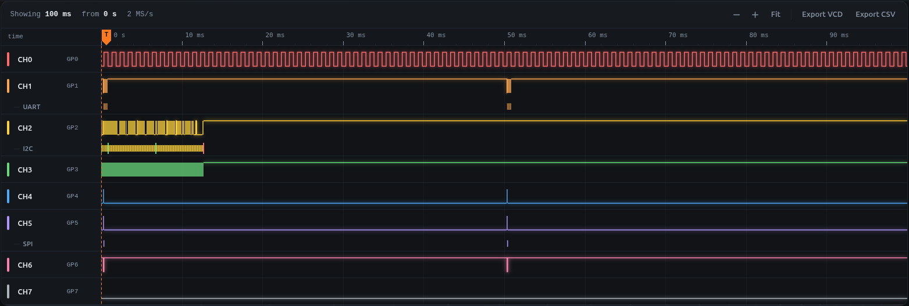
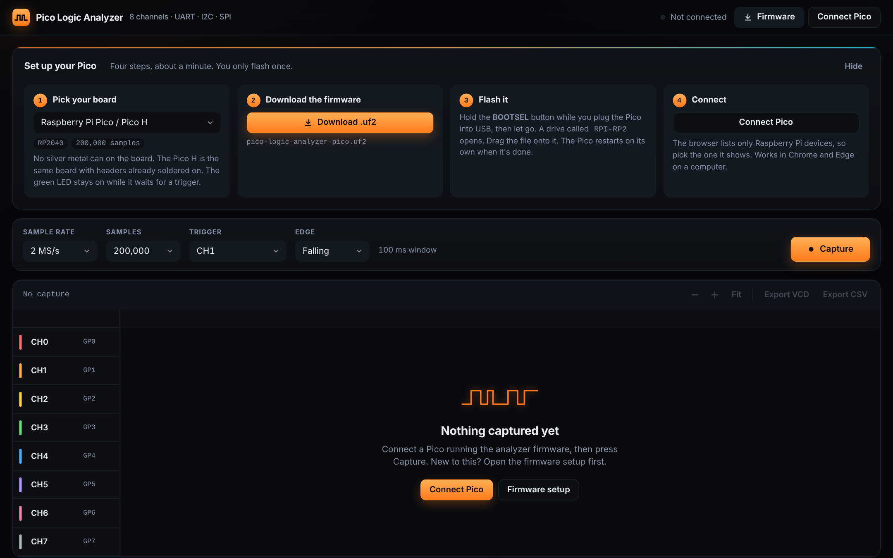
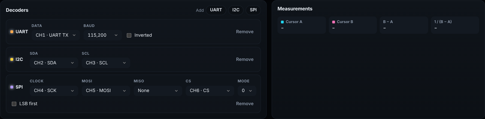
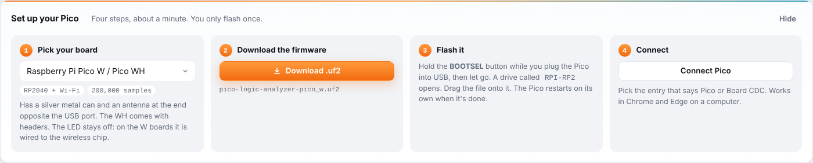
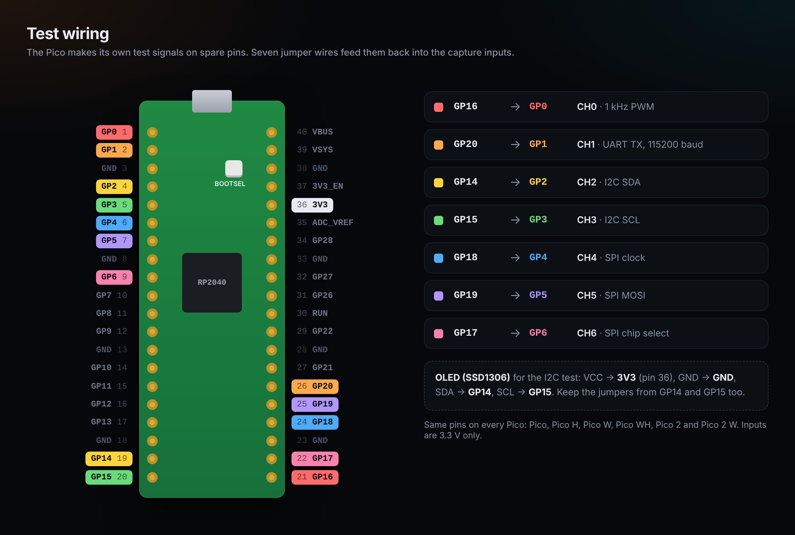
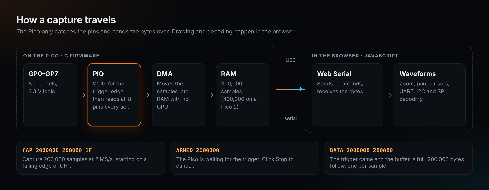

# Pico Logic Analyzer

An 8-channel logic analyzer made from one Raspberry Pi Pico. The Pico samples its pins into RAM, and a web page draws the waveforms and decodes UART, I2C and SPI. There's nothing to install: flash the firmware, open the page in Chrome or Edge, and click Connect.

It runs on every Pico: the Pico, Pico H, Pico W, Pico WH, Pico 2 and Pico 2 W.

**[Open the app](https://siammohammad10.github.io/Weekend-Projects/pico-logic-analyzer/web/)**. It needs a Pico with the firmware on it: everything you see in it comes from your board.



A real capture from a Pico H with the [test wiring](#test-wiring): the 1 kHz PWM on CH0, `hello` over UART on CH1, the I2C write to the OLED on CH2 and CH3, and `PICO` over SPI on CH4 to CH6, each with its decoder.

Before you connect, the app shows the firmware setup steps:



## What it does

| | |
| --- | --- |
| Channels | 8, on GP0 to GP7 |
| Sample rate | 10 kS/s to 100 MS/s, in steps that divide the 100 MHz system clock |
| Boards | Pico, Pico H, Pico W, Pico WH, Pico 2, Pico 2 W |
| Capture length | 200,000 samples on the RP2040 boards, 400,000 on the RP2350 boards (Pico 2 and Pico 2 W) |
| Trigger | Rising or falling edge on any channel, or start right away |
| Decoders | UART (any common baud, normal or inverted), I2C (start, address, data, ACK/NACK, stop), SPI (modes 0 to 3, MSB or LSB first, optional chip select, MOSI and MISO) |
| Measurements | Two cursors with time and frequency between them, plus frequency, duty cycle and edge count per channel |
| Export | VCD for PulseView or GTKWave, CSV of the decoded values |
| Inputs | 3.3 V only (see [Safety](#safety)) |

Scroll to zoom, drag to pan, click to place cursor A, and shift-click or right-click for cursor B. Click any row in the decoded list to jump to it.

Add a decoder for each bus you want read, and pick which channels it uses. Rename the channels to match your wiring and the names follow everywhere. The decoded bytes show up under the waveform and in a list you can export.



## Set up your Pico

The quickest way is the **Firmware** panel at the top of the [web app](https://siammohammad10.github.io/Weekend-Projects/pico-logic-analyzer/web/): pick your board from the list and it gives you the right file. 



The same steps in full:

### 1. Find out which board you have

| Board | How to tell | Chip | Capture length | Firmware |
| --- | --- | --- | --- | --- |
| Pico, Pico H | No silver metal can. The H has headers already soldered on. | RP2040 | 200,000 samples | [pico-logic-analyzer-pico.uf2](https://github.com/siammohammad10/Weekend-Projects/raw/main/pico-logic-analyzer/firmware/dist/pico-logic-analyzer-pico.uf2) |
| Pico W, Pico WH | A silver metal can and an antenna at the end opposite the USB port | RP2040 | 200,000 samples | [pico-logic-analyzer-pico_w.uf2](https://github.com/siammohammad10/Weekend-Projects/raw/main/pico-logic-analyzer/firmware/dist/pico-logic-analyzer-pico_w.uf2) |
| Pico 2 | The main chip is marked RP2350, with no metal can | RP2350 | 400,000 samples | [pico-logic-analyzer-pico2.uf2](https://github.com/siammohammad10/Weekend-Projects/raw/main/pico-logic-analyzer/firmware/dist/pico-logic-analyzer-pico2.uf2) |
| Pico 2 W | The main chip is marked RP2350, plus the metal can and antenna | RP2350 | 400,000 samples | [pico-logic-analyzer-pico2_w.uf2](https://github.com/siammohammad10/Weekend-Projects/raw/main/pico-logic-analyzer/firmware/dist/pico-logic-analyzer-pico2_w.uf2) |

Click the file for your board to download it. All four are also in [`firmware/dist`](firmware/dist).

Picked the wrong file? Nothing breaks. Flash the right one over it the same way.

### 2. Flash the firmware

1. Unplug the Pico.
2. Hold down the white **BOOTSEL** button on the board.
3. While still holding it, plug the Pico into your computer with a USB data cable. Then let go of the button.
4. A new drive appears, like a USB stick. It's called **RPI-RP2** on the Pico and Pico W, or **RP2350** on the Pico 2 and Pico 2 W.
5. Drag the `.uf2` file onto that drive.
6. The drive disappears by itself after a second or two. That means the Pico restarted with the new firmware. Your computer may say the drive wasn't ejected properly. That's normal and safe to ignore.

You only need to flash once. The firmware stays on the Pico when it's unplugged. To put something else on the Pico later, such as MicroPython, flash that `.uf2` the same way.

### 3. Connect from the browser

1. Open the [web app](https://siammohammad10.github.io/Weekend-Projects/pico-logic-analyzer/web/) in **Chrome or Edge** on Windows, macOS, Linux or ChromeOS. Firefox works from version 151. Safari and phones can't use USB serial yet.
2. Click **Connect Pico**. The browser opens a list that only shows Raspberry Pi devices. Pick the one there and click **Connect**.
3. The top of the page shows which board it found, for example *Pico W connected · 200,000 samples*.

On Linux, if the Pico shows up but won't connect, your account may not have permission to use serial ports. Run `sudo usermod -aG dialout $USER`, then log out and back in.

### 4. Make your first capture

1. Choose a **sample rate**. Sample at least 4 times faster than the fastest signal, and 10 times is better. For 115200-baud UART, 2 MS/s is plenty.
2. Choose how many **samples** to take. The toolbar shows how long that window is.
3. Choose a **trigger**: a channel and an edge to start on, or *None* to start right away.
4. Click **Capture**. On the Pico, Pico H and Pico 2, the green LED stays on while it waits for the trigger. On the W boards the LED is wired to the wireless chip, so it stays off. Click **Stop** if the trigger never comes.

### Test wiring

The firmware makes its own test signals on spare pins, so you can check everything with a few jumper wires and no other board. Run a jumper from each highlighted pin on the right side of the board to the pin of the same color on the left.



| Signal | Comes out of | Jumper it to |
| --- | --- | --- |
| 1 kHz PWM | GP16 | GP0 |
| UART TX, 115200 baud, `hello\n` every 50 ms | GP20 | GP1 |
| I2C SDA, 100 kHz, an SSD1306 OLED at 0x3C | GP14 | GP2 |
| I2C SCL | GP15 | GP3 |
| SPI clock, 500 kHz, mode 0, `PICO` every 50 ms | GP18 | GP4 |
| SPI MOSI | GP19 | GP5 |
| SPI chip select | GP17 | GP6 |

For the I2C test, connect an SSD1306 OLED to GP14 and GP15 and power it from 3V3. The firmware draws a counter on it every 250 ms, so there's I2C traffic to capture. Without an OLED you'll still see the address go out, followed by a NACK.

To try the decoders, add UART on channel 1, I2C on channels 2 and 3, and SPI on channels 4, 5 and 6, then trigger on a falling edge of channel 1, 2 or 6.

## How it works



**Firmware.** One PIO state machine runs a program that's built when each capture starts. With a trigger, it first waits for the opposite level and then for the edge. After that it runs `in pins, 8` on every tick of its clock. Autopush packs four samples into each 32-bit word, and a DMA channel moves them from the FIFO into RAM without the CPU. When the buffer is full, the Pico sends it over USB serial. The system clock runs at 100 MHz, so every sample rate the app offers is a whole-number divider.

**Protocol.** The browser sends one text command per line:

| Command | Reply |
| --- | --- |
| `ID` | `PLA 1 <max samples> <clock Hz> <board>` |
| `CAP <rate> <samples> <trigger>` | `ARMED <rate>`, then later `DATA <rate> <samples>` followed by the raw bytes |
| `ABORT` | `ABORTED` |

The trigger is `N` for none, or a channel and an edge: `1F` is a falling edge on channel 1. In each byte, bit n is channel n.

**Web app.** Plain HTML, CSS and JavaScript, with no framework and no build step. Each capture's edges are found once, so drawing and decoding only look at the places where something changes, and a 400,000-sample capture redraws as fast as a short one. Columns with many edges are drawn as a solid band.

```
pico-logic-analyzer/
├── firmware/
│   ├── CMakeLists.txt
│   ├── src/
│   │   ├── main.c            USB commands and the main loop
│   │   ├── capture.c         PIO program, DMA and the trigger
│   │   └── test_signals.c    PWM, UART, SPI and the OLED on spare pins
│   ├── build-all.sh          Builds every board into dist/
│   └── dist/                 Ready-to-flash .uf2 files, one per board
├── web/
│   ├── index.html
│   ├── css/app.css
│   └── js/
│       ├── boards.js         The supported boards and their firmware files
│       ├── device.js         Web Serial and the protocol
│       ├── capture.js        Samples, edges and measurements
│       ├── view.js           The waveform canvas
│       ├── decoders/         uart.js, i2c.js, spi.js
│       ├── export.js         VCD and CSV
│       └── app.js            The page
├── tests/
│   ├── decoders.test.js
│   └── signals.js            Known signals for the tests (not used by the app)
└── docs/
```

## Building the firmware

You need the [Pico SDK](https://github.com/raspberrypi/pico-sdk) (2.1 or later) and the Arm GCC toolchain. The Raspberry Pi Pico extension for VS Code installs both.

```sh
cd firmware
export PICO_SDK_PATH=/path/to/pico-sdk
cmake -S . -B build -DPICO_BOARD=pico      # or pico_w, pico2, pico2_w
cmake --build build
```

The output is `build/logic_analyzer.uf2`. To build all four boards into `dist/` at once, run `./build-all.sh`.

The firmware tells the web app which board it was built for, so the app can show it and pick the right capture length. On the W boards it leaves GP25 and the LED alone, because they belong to the wireless chip.

## Tests

The decoders are checked against generated signals at several sample rates:

```sh
node tests/decoders.test.js
```

## Troubleshooting

| What happens | What to try |
| --- | --- |
| No drive appears when you plug in with BOOTSEL held | Hold the button before the cable goes in, not after. Try another cable: many cheap cables only carry power. |
| The Connect list is empty | Flash the firmware first. Use a data cable. Close any other program that has the port open, such as Thonny or the Arduino serial monitor. |
| "That port didn't answer like the analyzer firmware" | The Pico is running something else. Flash the `.uf2` for your board again. |
| Capture never finishes | The trigger edge isn't happening. Click Stop, then check the wire, the ground connection and the edge, or set the trigger to None. |
| The UART decoder shows a warning or wrong characters | Raise the sample rate to at least 4 times the baud rate, and check the baud setting. |
| I2C shows only the address and a NACK | Nothing answered. Check the OLED's power (3V3 and GND) and its SDA and SCL wires. |
| The LED never lights on a Pico W or Pico 2 W | That's expected. The LED on the W boards belongs to the wireless chip. |

## Safety

The Pico's pins are 3.3 V. Don't connect a 5 V board, such as an Arduino Uno, straight to GP0 to GP7. Put a level buffer like a 74LVC245 or 74HC4050 in between, and always connect the target's ground to the Pico's ground.

## What's next

- A level buffer board, so it can probe 5 V logic
- Samples from before the trigger, using a ring buffer
- Longer captures with run-length encoding
- 16 channels on a Pico 2
- Triggers on a pattern across several channels

## Credits

[gusmanb/logicanalyzer](https://github.com/gusmanb/logicanalyzer) is the well-known Pico logic analyzer and was a good reference. This one is smaller and runs its interface in the browser, so there's nothing to install on the computer.

## Author

Mohammad Siam, Electrical Engineering, Texas Tech University.

## License

MIT. See [LICENSE](LICENSE).
