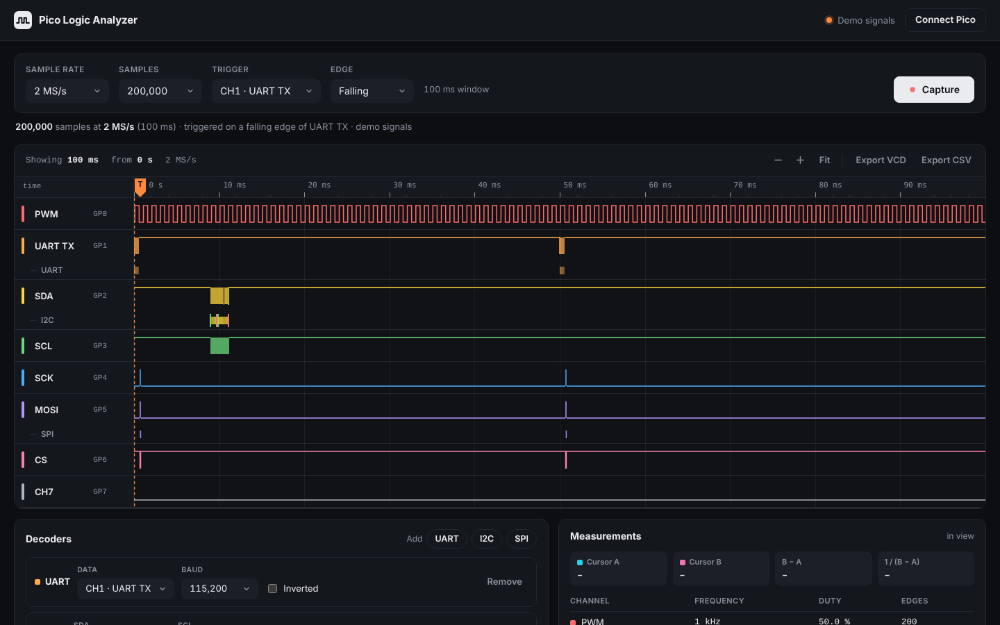
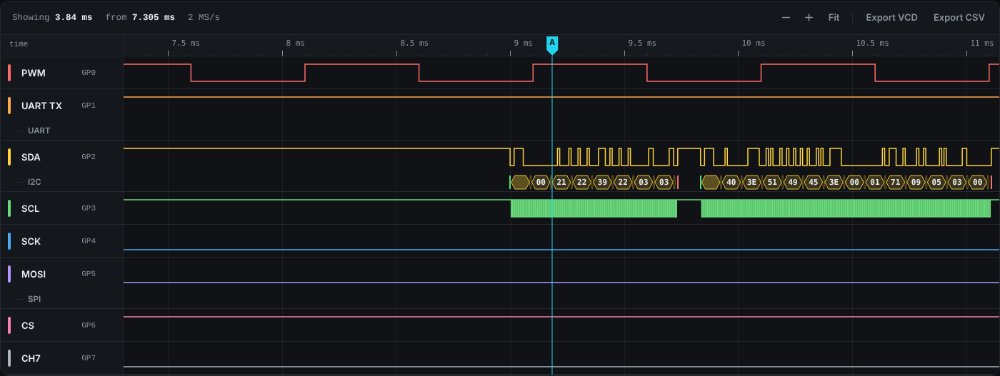

# Pico Logic Analyzer

An 8-channel logic analyzer made from one Raspberry Pi Pico. The Pico samples its pins into RAM, and a web page draws the waveforms and decodes UART, I2C and SPI. There's nothing to install: flash the firmware, open the page in Chrome or Edge, and click Connect.

**[Try it in your browser](https://siammohammad10.github.io/Weekend-Projects/pico-logic-analyzer/web/?demo)**. The demo plays the same test signals the firmware makes, so you can try the decoders without a Pico.



## What it does

| | |
| --- | --- |
| Channels | 8, on GP0 to GP7 |
| Sample rate | 10 kS/s to 100 MS/s, in steps that divide the 100 MHz system clock |
| Capture length | 200,000 samples on a Pico, 400,000 on a Pico 2 |
| Trigger | Rising or falling edge on any channel, or start right away |
| Decoders | UART (any common baud, normal or inverted), I2C (start, address, data, ACK/NACK, stop), SPI (modes 0 to 3, MSB or LSB first, optional chip select, MOSI and MISO) |
| Measurements | Two cursors with time and frequency between them, plus frequency, duty cycle and edge count per channel |
| Export | VCD for PulseView or GTKWave, CSV of the decoded values |
| Inputs | 3.3 V only (see [Safety](#safety)) |

Scroll to zoom, drag to pan, click to place cursor A, and shift-click or right-click for cursor B. Click any row in the decoded list to jump to it.



## Try it with a Pico

1. Hold BOOTSEL while plugging in the Pico, then drag the `.uf2` file for your board onto the drive that appears:
   - Pico or Pico H: [`firmware/dist/pico-logic-analyzer-pico.uf2`](firmware/dist/pico-logic-analyzer-pico.uf2)
   - Pico 2: [`firmware/dist/pico-logic-analyzer-pico2.uf2`](firmware/dist/pico-logic-analyzer-pico2.uf2)
2. Open the [web app](https://siammohammad10.github.io/Weekend-Projects/pico-logic-analyzer/web/) in Chrome or Edge on a computer, or Firefox 151 and later. Safari and phones don't support Web Serial.
3. Click **Connect Pico** and pick the Pico from the list.
4. Choose a sample rate, a trigger and a capture length, then click **Capture**.

The onboard LED stays on while the Pico waits for the trigger.

### Test wiring

The firmware makes its own test signals on spare pins, so you can check everything with a few jumper wires and no other board.

| Signal | Comes out of | Jumper it to |
| --- | --- | --- |
| 1 kHz PWM | GP16 | GP0 |
| UART TX, 115200 baud, `hello\n` every 50 ms | GP20 | GP1 |
| I2C SDA, 100 kHz, an SSD1306 OLED at 0x3C | GP14 | GP2 |
| I2C SCL | GP15 | GP3 |
| SPI clock, 500 kHz, mode 0, `PICO` every 50 ms | GP18 | GP4 |
| SPI MOSI | GP19 | GP5 |
| SPI chip select | GP17 | GP6 |

For the I2C test, connect an SSD1306 OLED to GP14 and GP15 and power it from 3V3. The firmware draws a counter on it every 250 ms, so there's I2C traffic to capture. Without an OLED you'll still see the address go out, followed by a NACK.

To try the decoders, add UART on channel 1, I2C on channels 2 and 3, and SPI on channels 4, 5 and 6, then trigger on a falling edge of channel 1, 2 or 6.

## How it works

```
 pins ──▶ PIO ──▶ DMA ──▶ RAM buffer ──USB──▶ Web Serial ──▶ waveform + decoders
         (8 bits    (no CPU)  (1 byte per                    (all in the browser)
          per tick)            sample)
```

**Firmware.** One PIO state machine runs a program that's built when each capture starts. With a trigger, it first waits for the opposite level and then for the edge. After that it runs `in pins, 8` on every tick of its clock. Autopush packs four samples into each 32-bit word, and a DMA channel moves them from the FIFO into RAM without the CPU. When the buffer is full, the Pico sends it over USB serial. The system clock runs at 100 MHz, so every sample rate the app offers is a whole-number divider.

**Protocol.** The browser sends one text command per line:

| Command | Reply |
| --- | --- |
| `ID` | `PLA 1 <max samples> <clock Hz>` |
| `CAP <rate> <samples> <trigger>` | `ARMED <rate>`, then later `DATA <rate> <samples>` followed by the raw bytes |
| `ABORT` | `ABORTED` |

The trigger is `N` for none, or a channel and an edge: `1F` is a falling edge on channel 1. In each byte, bit n is channel n.

**Web app.** Plain HTML, CSS and JavaScript, with no framework and no build step. Each capture's edges are found once, so drawing and decoding only look at the places where something changes, and a 400,000-sample capture redraws as fast as a short one. Columns with many edges are drawn as a solid band.

```
pico-logic-analyzer/
├── firmware/
│   ├── CMakeLists.txt
│   ├── src/
│   │   ├── main.c            USB commands and the main loop
│   │   ├── capture.c         PIO program, DMA and the trigger
│   │   └── test_signals.c    PWM, UART, SPI and the OLED on spare pins
│   └── dist/                 Ready-to-flash .uf2 files
├── web/
│   ├── index.html
│   ├── css/app.css
│   └── js/
│       ├── device.js         Web Serial and the protocol
│       ├── capture.js        Samples, edges and measurements
│       ├── view.js           The waveform canvas
│       ├── decoders/         uart.js, i2c.js, spi.js
│       ├── demo.js           Demo signals
│       ├── export.js         VCD and CSV
│       └── app.js            The page
├── tests/
│   ├── decoders.test.js
│   └── mock-serial.js        A fake Pico for browser tests
└── docs/
```

## Building the firmware

You need the [Pico SDK](https://github.com/raspberrypi/pico-sdk) (2.1 or later) and the Arm GCC toolchain. The Raspberry Pi Pico extension for VS Code installs both.

```sh
cd firmware
export PICO_SDK_PATH=/path/to/pico-sdk
cmake -S . -B build -DPICO_BOARD=pico      # or pico2
cmake --build build
```

The output is `build/logic_analyzer.uf2`.

## Tests

The decoders are checked against generated signals at several sample rates:

```sh
node tests/decoders.test.js
```

`tests/mock-serial.js` stands in for `navigator.serial` and answers like the firmware does, including captures that wait on a trigger and get stopped. Load it before the app to test connecting, capturing and stopping in a browser without a Pico.

## Safety

The Pico's pins are 3.3 V. Don't connect a 5 V board, such as an Arduino Uno, straight to GP0 to GP7. Put a level buffer like a 74LVC245 or 74HC4050 in between, and always connect the target's ground to the Pico's ground.

## What's next

- A level buffer board, so it can probe 5 V logic
- Samples from before the trigger, using a ring buffer
- Longer captures with run-length encoding
- 16 channels on a Pico 2
- Triggers on a pattern across several channels

## Credits

[gusmanb/logicanalyzer](https://github.com/gusmanb/logicanalyzer) is the well-known Pico logic analyzer and was a good reference. This one is smaller and runs its interface in the browser, so there's nothing to install on the computer.

## Author

Mohammad Siam, Electrical Engineering, Texas Tech University.

## License

MIT. See [LICENSE](LICENSE).
